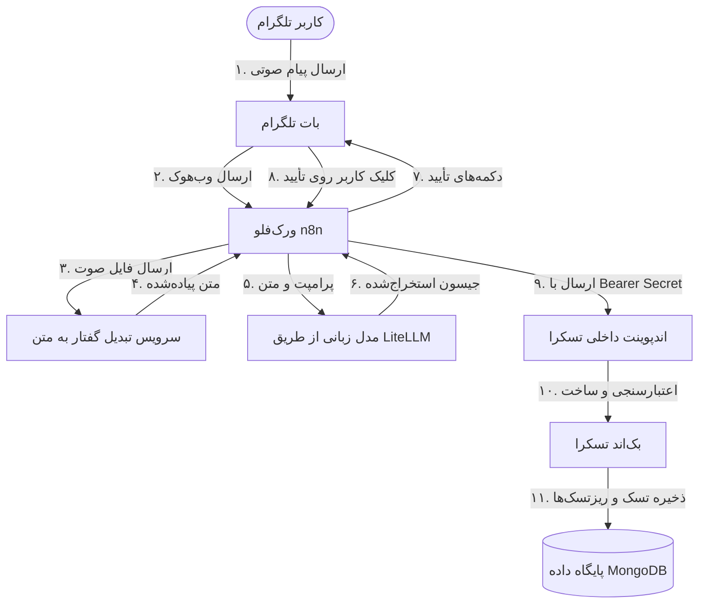
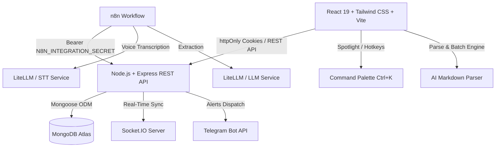

<p align="right" dir="rtl">
  🌐 <b>زبان:</b> 🇮🇷 فارسی | <a href="./README.md"><b>🇺🇸 English</b></a>
</p>

# تسکرا (Taskera) — پلتفرم هوشمند مدیریت تسک و فضای کاری

<div align="center">


[](https://react.dev)
[](https://nodejs.org)
[](https://mongodb.com)
[](https://core.telegram.org/bots/api)
[](https://tailwindcss.com)

<p align="center">
  یک پلتفرم مدرن و فول‌استک برای مدیریت تسک و فضای کاری با قابلیت ساخت تسک از طریق وویس تلگرام با هوش مصنوعی، ایمپورت گروهی مارک‌داون، اعلان‌های درلحظه تلگرام، رهگیری زمان و کنترل دسترسی نقش‌محور (RBAC) در فضاهای شخصی و تیمی.
</p>

[دموی آنلاین (Live Demo)](https://parham-codes.github.io/Taskera) • [پروفایل گیت‌هاب](https://github.com/Parham-Codes) • [گزارش باگ یا پیشنهاد](https://github.com/Parham-Codes/taskera/issues)

</div>

---

## 🌟 معرفی پروژه

**تسکرا (Taskera)** برای افزایش چشمگیر بهره‌وری جریان‌های کاری فردی و تیم‌های اشتراکی طراحی شده است. این سیستم سادگی و سرعت مدیریت تسک شخصی را در کنار پایداری و قدرت ابزارهای چندمستأجره (Multi-Tenant) سازمانی، یکپارچه‌سازی درلحظه با ربات تلگرام و اتوماسیون صوتی مبتنی بر هوش مصنوعی ارائه می‌دهد.

### 🚀 قابلیت‌های برجسته

- **معماری فضای کاری دوگانه (Dual-Mode):**
  - **فضای شخصی (Solo Mode):** مدیریت بی‌واسطه تسک‌های شخصی بدون نیاز به ساخت سازمان یا پیچیدگی‌های اولیه.
  - **فضای تیمی و سازمانی (Collaborative Mode):** ایجاد و پیوستن به فضاهای کاری تیمی، واگذاری تسک‌ها به اعضا، و پایش وضعیت با کنترل دسترسی نقش‌محور (مالک، مدیر، عضو).
- **🎙️ دستیار صوتی هوشمند تلگرام (AI Voice-to-Task):**
  - **ساخت تسک با ارسال پیام صوتی:** با ارسال ویس به بات تلگرام، درخواست کاربر به صورت خودکار دریافت و پردازش می‌شود.
  - **تبدیل گفتار به متن:** با استفاده از مدل‌های هوش مصنوعی (STT)، محتوای صوتی به متن دقیق تبدیل می‌شود.
  - **استخراج هوشمند اطلاعات:** عنوان تسک، توضیحات، تاریخ سررسید، اولویت و مراحل فرعی (Subtasks) به صورت خودکار از درخواست کاربر استخراج می‌شوند.
  - **درک تاریخ‌های نسبی:** عباراتی مانند امروز، فردا و هفته آینده به تاریخ‌های استاندارد و دقیق تقویمی تبدیل می‌شوند.
  - **تأیید پیش از ثبت:** پیش‌نمایش کامل تسک در تلگرام نمایش داده می‌شود و کاربر می‌تواند آن را تأیید یا لغو کند.
  - **ثبت مستقیم در فضای شخصی:** پس از تأیید، تسک و مراحل آن در Personal Space حساب مرتبط با Chat ID کاربر ذخیره می‌شوند.
  - **پیگیری وضعیت عملیات:** پیام تلگرام در مراحل پردازش، موفقیت یا خطا به‌صورت داینامیک به‌روزرسانی می‌شود.
- **⚡ اعلان‌های درلحظه بات تلگرام (Telegram Bot Alerts):**
  - اتصال آسان اکانت تلگرام از طریق Chat ID یا بات اختصاصی.
  - دریافت آنی نوتیفیکیشن‌های فرمت‌شده برای ثبت تسک جدید، تغییر وضعیت‌ها و رویدادهای فضای کاری.
  - دارای سیستم تست اتصال یک‌کلیکه مستقیماً از داخل مودال تنظیمات برنامه.
- **✨ ایمپورت گروهی با هوش مصنوعی و خروجی اکسل:**
  - ساخت ده‌ها تسک در کسری از ثانیه با کپی کردن ساختار متنی هوش مصنوعی (همراه با پرامپت آماده و یکپارچه در سیستم).
  - خروجی‌گیری کامل از تسک‌ها در قالب فایل‌های `.csv` (سازگار با اکسل) یا فایل مارک‌داون `.md`.
- **⏱️ رهگیری زمان و تایمر حرفه‌ای (Time Tracker):**
  - ثبت زمان صرف‌شده روی هر تسک با استفاده از کرونومتر زنده و تفکیک شده.
  - گزارش دقیق از بازه‌های زمانی کاری و مجموع ساعات ثبت شده.
- **⌨️ پالت دستورات سراسری (`Ctrl + K` / `Cmd + K`):**
  - جستجوی بلادرنگ در تمام تسک‌ها، عملکردهای پرکاربرد، دسته‌بندی‌ها، حالت‌های نمایش و تغییر تم.
- **💬 سیستم گفتگو و نظرات تسک‌ها:**
  - امکان ثبت کامنت‌های ساختاریافته به همراه زمان ثبت و پروفایل کاربر روی هر تسک.
- **🎨 طراحی لوکس، استاندارد و دو زبانه:**
  - رابط کاربری مینیمال با افکت‌های کنترل‌شده، تم دارک و لایت هوشمند، میکرو‌انیمیشن‌های روان و پشتیبانی کامل و اصولی از زبان‌های فارسی (RTL با فونت وزیرمتن) و انگلیسی (با فونت Plus Jakarta Sans).

---

## 🎙️ دستیار صوتی هوشمند تلگرام

تسکرا دارای یک دستیار صوتی هوشمند برای ساخت تسک است که از طریق ارتباط میان تلگرام، پایپ‌لاین اتوماسیون **n8n**، سرویس‌های **LiteLLM / STT** و API امن داخلی تسکرا کار می‌کند.

### الف) نحوه عملکرد قابلیت

۱. کاربر یک **پیام صوتی (Voice Note)** در گفتگوی خصوصی تلگرام برای بات ارسال می‌کند.  
۲. ورک‌فلو **n8n** پیام صوتی را از وب‌هوک تلگرام دریافت می‌کند.  
۳. فایل صوتی جهت تبدیل گفتار به متن به سرویس STT (مانند Whisper) ارسال می‌شود.  
۴. متن استخراج‌شده برای تحلیل به مدل زبانی (LLM) ارسال می‌گردد.  
۵. مدل هوش مصنوعی، اطلاعات تسک را در یک ساختار استاندارد JSON (شامل عنوان، توضیحات، تاریخ سررسید، اولویت و ریزتسک‌ها) استخراج می‌کند.  
۶. پیش‌نمایش کاملی از تسک همراه با دکمه‌های شیشه‌ای «تأیید» و «لغو» برای کاربر در تلگرام ارسال می‌شود.  
۷. کاربر درخواست را بررسی کرده و روی **تأیید** کلیک می‌کند (ساخت تسک بدون تأیید صریح کاربر هرگز انجام نمی‌شود).  
۸. پس از تأیید، داده‌های استخراج‌شده از طریق Endpoint داخلی و امن تسکرا ارسال می‌شوند.  
۹. سرور تسکرا صحت اطلاعات و هویت کاربر از روی Chat ID تلگرام را بررسی کرده و تسک را همراه با تمام ریزتسک‌ها در فضای شخصی (Personal Space) کاربر ایجاد می‌کند.  
۱۰. پیام تلگرام بلافاصله ویرایش شده و نتیجه موفقیت به کاربر اعلام می‌شود.

### ب) نمونه خروجی هوش مصنوعی

ساختار استاندارد JSON تولیدشده توسط مدل هوش مصنوعی به شکل زیر است:

```json
{
  "title": "Prepare project presentation",
  "description": "Prepare the final presentation for the project.",
  "dueDate": "2026-11-12T23:59:00+03:30",
  "priority": "high",
  "subtasks": [
    {
      "title": "Review project requirements"
    },
    {
      "title": "Prepare presentation slides"
    },
    {
      "title": "Practice the presentation"
    }
  ]
}
```

- فیلد `dueDate`: به صورت رشته تاریخ و زمان استاندارد ISO بازگردانده می‌شود و در صورت عدم تعیین مهلت در پیام صوتی، مقدار `null` خواهد بود.
- فیلد `priority`: بر اساس لحن و اولویت پیام به یکی از مقادیر `low`، `medium` یا `high` تنظیم می‌شود.
- فیلد `subtasks`: همیشه یک آرایه از مراحل فرعی است و در صورت نبود ریزتسک، یک آرایه خالی (`[]`) خواهد بود.

### ج) پیش‌نیازها

برای راه‌اندازی و استفاده از این قابلیت، بخش‌های زیر مورد نیاز هستند:

- **بک‌اند تسکرا** (همراه با تنظیم متغیر محیطی `N8N_INTEGRATION_SECRET`)
- **API بات تلگرام** (توکن بات اختصاصی برای دستیار صوتی)
- **ورک‌فلو اتوماسیون n8n** (مدیریت وب‌هوک تلگرام، اینلاین کیبورد تأیید و ارسال به تسکرا)
- **سرویس هوش مصنوعی / LiteLLM** (برای مدل STT مانند Whisper و مدل زبانی برای استخراج ساختاریافته)
- **اتصال حساب کاربری در تنظیمات تسکرا** (ثبت Chat ID و فعال‌سازی دستیار)

> [!NOTE]
> ورک‌فلو n8n و سرویس‌های هوش مصنوعی اجزای مستقل اتوماسیون هستند و جزو نیازمندی‌های داخلی سرور تسکرا محسوب نمی‌شوند و به صورت مجزا راه‌اندازی می‌گردند.

### د) فعال‌سازی از داخل تسکرا

۱. وارد حساب کاربری خود در تسکرا شوید.  
۲. پنجره تنظیمات تلگرام (`TelegramSettingsModal`) را باز کنید.  
۳. شناسه عددی چت تلگرام خود (**Chat ID**) را وارد کنید (قابل دریافت از ربات `@userinfobot`).  
۴. روی دکمه **ذخیره تنظیمات** کلیک کنید.  
۵. در بخش **دستیار صوتی تلگرام** (`TelegramAssistantSection`)، سوییچ فعال‌سازی را روشن کنید.  
۶. در گفتگوی خصوصی بات تلگرام، یک پیام صوتی بفرستید.

> [!IMPORTANT]
> فعال‌سازی دستیار صوتی مستلزم ثبت Chat ID معتبر است و در صورت خالی بودن شناسه، امکان فعال‌سازی وجود نخواهد داشت.

### ه) معماری و ارتباط سرویس‌ها



درخواست میان n8n و تسکرا با هدر `Authorization: Bearer <N8N_INTEGRATION_SECRET>` و با استفاده از مقایسه ایمن زمانی (`crypto.timingSafeEqual`) محافظت می‌شود تا از هرگونه نشت توکن یا حملات تایمینگ جلوگیری شود.

---

## 🔒 مستندات API داخلی دستیار تلگرام

تسکرا یک اندپوینت داخلی محافظت‌شده برای سرویس‌های اتوماسیون خارجی (مانند n8n) ارائه می‌دهد:

`POST /api/internal/telegram/assistant/tasks`

- **مسیر فایل روت:** [`server/src/routes/internalRoutes.js`](file:///server/src/routes/internalRoutes.js)
- **میدلور احراز هویت:** [`server/src/middlewares/n8nAuth.js`](file:///server/src/middlewares/n8nAuth.js)
- **متغیر محیطی:** `N8N_INTEGRATION_SECRET`
- **هدر احراز هویت:** `Authorization: Bearer <N8N_INTEGRATION_SECRET>`

### نمونه ساختار درخواست (Request Body)

```json
{
  "telegramUserId": "123456789",
  "telegramChatId": "123456789",
  "chatType": "private",
  "isBot": false,
  "task": {
    "title": "Prepare project presentation",
    "description": "Prepare the final presentation.",
    "dueDate": null,
    "priority": "medium",
    "subtasks": [
      {
        "title": "Prepare the slides"
      },
      {
        "title": "Review the content"
      }
    ]
  }
}
```

### الزامات و قوانین امنیتی

- **تنها چت‌های خصوصی:** درخواست‌ها تنها در صورتی که `chatType === 'private'` باشد پذیرفته می‌شوند و پیام‌های ارسالی در گروه رد می‌شوند (`400 Bad Request`).
- **رد پیام بات:** پیام‌های ارسالی از طرف بات‌ها (`isBot: true`) رد می‌شوند (`400 Bad Request`).
- **تطابق شناسه کاربر و چت:** مقادیر `telegramUserId` و `telegramChatId` باید دقیقاً یکسان باشند.
- **اعتبارسنجی حساب کاربر:** کاربر بر اساس `telegramSettings.chatId === telegramUserId` و شرط فعال بودن دستیار (`assistantEnabled === true`) در دیتابیس جستجو می‌شود.
- **جلوگیری از ابهام حساب:** اگر بیش از یک حساب کاربری با این Chat ID ثبت شده باشد، درخواست با خطای `409 Conflict` رد می‌شود.
- **مقصد فضای شخصی:** تسک از طریق `taskCrudService.createTask` با `organizationId: null` در فضای شخصی (Personal Space) کاربر ایجاد می‌گردد.
- **پالایش ریزتسک‌ها:** فیلد `subtasks` به طور ایمن فیلتر شده و تنها مواردی که دارای عنوان معتبر و Trim شده هستند ذخیره می‌شوند.

---

## 🛠️ معماری و استک فنی



| لایه | تکنولوژی‌های استفاده‌شده |
|---|---|
| **فرانت‌اند** | React 19، Vite، Tailwind CSS، Lucide Icons، فونت وزیرمتن و Plus Jakarta Sans |
| **بک‌اند** | Node.js (ES Modules)، Express، Helmet، Rate Limiter، Cookie Parser، Socket.IO |
| **پایگاه داده** | MongoDB همراه با Mongoose (ایندکس‌های ترکیبی، متدهای Lean بهینه) |
| **احراز هویت** | سشن‌های امن مبتنی بر توکن‌های JWT ذخیره در کوکی‌های `httpOnly` با سیستم رفرش توکن خودکار |
| **سرویس‌های خارجی و اتوماسیون** | API تلگرام (Telegram Bot API)، اتوماسیون فرآیند n8n، اندپوینت‌های سازگار با LiteLLM برای STT/LLM، پردازشگر مارک‌داون و خروجی CSV |

---

## 📁 ساختار پوشه‌های پروژه

```
taskera/
├── client/                     # برنامه فرانت‌اند (React + Vite)
│   ├── src/
│   │   ├── api/                # کلاینت ارتباطی Axios و ماژول‌های API
│   │   ├── components/         # کامپوننت‌های پایه رابط کاربری، ContextMenu و پالت دستورات
│   │   ├── context/            # کانتکست‌های سراسری (Auth, Workspace, Theme, Lang, Category, Notification)
│   │   ├── features/           # بخش‌های اصلی اپ (تسک‌ها، دسته‌ها، بات تلگرام)
│   │   │   ├── tasks/          # نماهای کانبان، استک، لیست، تقویم و مودال‌ها
│   │   │   ├── categories/     # مدیریت و ویرایش دسته‌بندی‌ها
│   │   │   └── telegram/       # تنظیمات تلگرام و بخش دستیار صوتی
│   │   ├── layouts/            # سایدبار، هدر بالا و فوتر
│   │   └── i18n/               # دیکشنری کامل دو زبانه (فارسی / انگلیسی)
│   └── public/                 # دارایی‌های وکتور و فاوآیکون اختصاصی
│
└── server/                     # وب‌سرویس و بک‌اند (Node.js + Express)
    ├── src/
    │   ├── config/             # تنظیمات دیتابیس و متغیرهای محیطی
    │   ├── controllers/        # کنترلرها و هندلرهای ریکوئست (تسک، احراز هویت، تلگرام، دستیار)
    │   ├── middlewares/        # اعتبارسنجی احراز هویت، RBAC، احراز هویت n8n، و محدودساز نرخ
    │   ├── models/             # اسکیمای Mongoose (کاربر، تسک، سازمان، عضویت، دسته‌بندی)
    │   ├── routes/             # روت‌های ماژولار REST و اندپوینت‌های داخلی
    │   └── services/           # منطق تسک‌ها، Socket.IO، یادآورها و سرویس تلگرام
    ├── scripts/                # اسکریپت‌های کاربردی (setTelegramWebhook)
    └── tests/                  # تست‌های خودکار یکپارچگی (auth, rbac, socket, assistant)
```

---

## ⚡ راهنمای راه‌اندازی و اجرا

### ۱. پیش‌نیازها
- **Node.js**: نسخه ۱۸ به بالا
- **MongoDB**: نسخه لوکال یا رایگان MongoDB Atlas

### ۲. کلون کردن ریپازیتوری
```bash
git clone https://github.com/Parham-Codes/taskera.git
cd taskera
```

### ۳. راه‌اندازی بخش بک‌اند (سرور)
```bash
cd server
npm install
```

یک فایل به نام `.env` در پوشه `server/` بسازید و مقادیر زیر را در آن تنظیم کنید:
```env
PORT=7000
NODE_ENV=development
CLIENT_URL=http://localhost:5173
MONGO_URI=mongodb_connection_string_شما

# کلیدهای JWT اجباری هستند و در صورت عدم تنظیم، برنامه متوقف می‌شود
JWT_ACCESS_SECRET=کلید_امنیتی_اکسس_توکن
JWT_REFRESH_SECRET=کلید_امنیتی_رفرش_توکن

# توکن ربات تلگرام برای اعلان‌ها (اختیاری)
TELEGRAM_BOT_TOKEN=توکن_ربات_تلگرام_شما

# فقط در صورت استفاده از دستیار صوتی تلگرام و n8n الزامی است
N8N_INTEGRATION_SECRET=یک_رشته_طولانی_و_تصادفی_امنیتی
```

سرور را اجرا کنید:
```bash
npm run dev
```

### ۴. راه‌اندازی دستیار صوتی تلگرام در n8n (اختیاری)

در صورت تمایل به راه‌اندازی دستیار صوتی هوشمند:
۱. مقدار متغیر `N8N_INTEGRATION_SECRET` را در محیط اجرای بک‌اند خود (مانند Render یا فایل `.env` لوکال) تنظیم کنید.  
۲. در ورک‌فلو n8n، نود HTTP Request را به این صورت تنظیم نمایید:
   - **Method:** `POST`
   - **URL:** `https://your-backend-domain.com/api/internal/telegram/assistant/tasks`
   - **Header:** `Authorization: Bearer <N8N_INTEGRATION_SECRET_شما>`
۳. اطمینان حاصل کنید که ورک‌فلو n8n صوت را از مدل STT عبور داده، خروجی جیسون را با مدل LLM آماده می‌کند و پیش از ارسال، تأیید کاربر را در تلگرام دریافت می‌نماید.

### ۵. راه‌اندازی بخش فرانت‌اند (کلاینت)
در یک ترمینال جداگانه:
```bash
cd client
npm install
npm run dev
```

برنامه در آدرس `http://localhost:5173` در دسترس شماست.

---

## 👤 سازنده و توسعه‌دهنده

طراحی و پیاده‌سازی توسط **پرهام تقی‌خانی (Parham Taghikhani)**

- **گیت‌هاب:** [@Parham-Codes](https://github.com/Parham-Codes)
- **وب‌سایت و پورتفولیو:** [parham-codes.github.io/portfolio](https://parham-codes.github.io/portfolio/)
- **ایمیل:** [parhamtaghikhani.31@gmail.com](mailto:parhamtaghikhani.31@gmail.com)

---

## 📄 لایسنس

این پروژه تحت لایسنس [MIT License](LICENSE) منتشر شده است.

---

<div align="center">

### ⭐ اگر این پروژه برای شما کاربردی یا الهام‌بخش بود، خوشحال می‌شم بهش در گیت‌هاب استار بدید!

</div>
