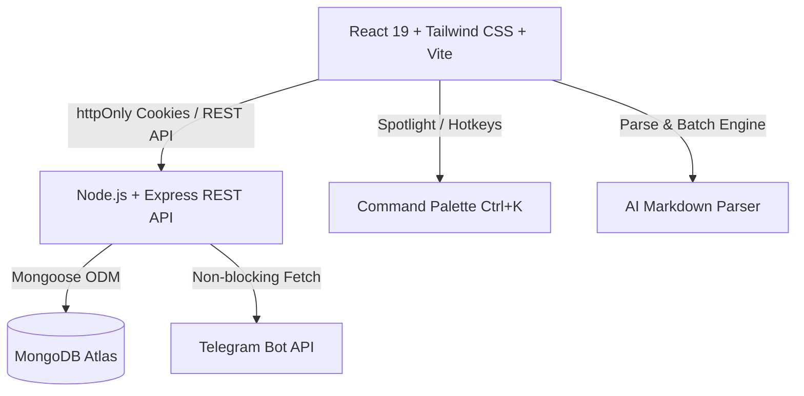

<p align="right">
  🌐 <b>Language:</b> 🇺🇸 English | <a href="./README.fa.md"><b>🇮🇷 فارسی</b></a>
</p>

# Taskera — Smart Workspace with Telegram Bot & AI Markdown Sync

<div align="center">


[](https://react.dev)
[](https://nodejs.org)
[](https://mongodb.com)
[](https://core.telegram.org/bots/api)
[](https://tailwindcss.com)

<p align="center">
  A high-performance, full-stack Task & Workspace Platform featuring Real-Time Telegram Bot Alerts, AI Markdown Batch Sync, Time Tracking & Granular RBAC.
</p>

[Live Demo](https://parham-codes.github.io/Taskera) • [Author Profile](https://github.com/Parham-Codes) • [Report Issue](https://github.com/Parham-Codes/taskera/issues)

</div>

---

## 🌟 Overview

**Taskera** is designed for high-efficiency individual workflows and collaborative team workspaces. It merges the simplicity of zero-friction personal task management with the robustness of multi-tenant enterprise organization tools.

### 🚀 Key Highlights

- **Dual-Mode Workspace Architecture:**
  - **Personal Space (Solo Mode):** Immediate task management with zero friction or setup needed.
  - **Organization / Team Space (Collaborative Mode):** Create or join workspaces, delegate tasks, and track team velocity with Role-Based Access Control (Owner, Manager, Member).
- **⚡ Real-Time Telegram Bot Alerts:**
  - Connect your Telegram account via Chat ID or custom bot token.
  - Receive instant formatted notifications for newly assigned tasks, status transitions, and workspace events.
  - Test connection with 1-click test dispatches directly from the web app.
- **✨ AI Markdown Batch Import & Excel Export:**
  - Paste structured AI-generated Markdown (or use our built-in one-click prompt) to create tens of tasks in milliseconds.
  - Export workspace tasks into `.csv` (Excel compatible) or structured `.md` files.
- **⏱️ Integrated Time Tracker & Stopwatch:**
  - Track time spent per task with live second-by-second stopwatch sessions.
  - Detailed historical breakdown of work intervals and total elapsed time.
- **⌨️ Universal Command Palette (`Ctrl + K` / `Cmd + K`):**
  - Instant spotlight search across all tasks, workspace actions, category managers, view modes, and theme toggling.
- **💬 Task Discussion & Comments:**
  - Dedicated threaded discussions per task for real-time collaboration.
- **🎨 Rich Modern Aesthetic:**
  - Polished glassmorphism UI with curated color palettes, dark & light themes, micro-animations, and full RTL/LTR bilingual support (Persian & English).

---

## 🛠️ Architecture & Tech Stack



| Layer | Technologies |
|---|---|
| **Frontend** | React 19, Vite, Tailwind CSS, Lucide Icons, Vazirmatn & Plus Jakarta Sans |
| **Backend** | Node.js (ES Modules), Express, Helmet, Rate Limiter, Cookie Parser |
| **Database** | MongoDB with Mongoose (Indexed queries, Lean operations) |
| **Authentication** | Secure `httpOnly` JWT sessions with silent refresh token rotation |
| **Integrations** | Telegram Bot API, Custom CSV / Markdown streaming serializers |

---

## 📁 Repository Structure

```
taskera/
├── client/                     # Frontend SPA (React + Vite)
│   ├── src/
│   │   ├── api/                # API Axios client & endpoint modules
│   │   ├── components/         # Reusable UI primitives & CommandPalette
│   │   ├── context/            # Global contexts (Auth, Workspace, Theme, Lang)
│   │   ├── features/           # Feature slices (tasks, categories, telegram)
│   │   ├── layouts/            # Sidebar, TopHeader, and Footer
│   │   └── i18n/               # Comprehensive bilingual dictionary (FA / EN)
│   └── public/                 # Optimized vector brand favicon & assets
│
└── server/                     # Backend API (Node.js + Express)
    ├── src/
    │   ├── config/             # Database connection & env configs
    │   ├── controllers/        # Request handlers
    │   ├── middlewares/        # Auth verification, RBAC, Rate-limiters
    │   ├── models/             # Strict Mongoose Schemas (User, Task, Org, Member)
    │   ├── routes/             # Isolated modular REST routes
    │   └── services/           # Business logic & Telegram notification service
```

---

## ⚡ Quick Start

### 1. Prerequisites
- **Node.js**: v18.0.0 or higher
- **MongoDB**: Local MongoDB instance or free MongoDB Atlas URI

### 2. Clone the Repository
```bash
git clone https://github.com/Parham-Codes/taskera.git
cd taskera
```

### 3. Backend Setup
```bash
cd server
npm install
```

Create a `.env` file inside `server/`:
```env
PORT=7000
NODE_ENV=development
CLIENT_URL=http://localhost:5173
MONGO_URI=your_mongodb_connection_string
# JWT Secrets (Mandatory - server halts if not defined)
JWT_ACCESS_SECRET=your_jwt_access_secret_key_here
JWT_REFRESH_SECRET=your_jwt_refresh_secret_key_here
TELEGRAM_BOT_TOKEN=optional_default_telegram_bot_token
```

Start the backend server:
```bash
npm run dev
```

### 4. Frontend Setup
In a new terminal:
```bash
cd client
npm install
npm run dev
```

Open `http://localhost:5173` in your browser.

---

## 👤 Author

Developed by **Parham Taghikhani**

- **GitHub:** [@Parham-Codes](https://github.com/Parham-Codes)
- **Portfolio:** [parham-codes.github.io/portfolio](https://parham-codes.github.io/portfolio/)
- **Email:** [parhamtaghikhani.31@gmail.com](mailto:parhamtaghikhani.31@gmail.com)

---

## 📄 License

This project is licensed under the [MIT License](LICENSE).

---

<div align="center">

### ⭐ If you found this project helpful, consider giving it a Star!

</div>
