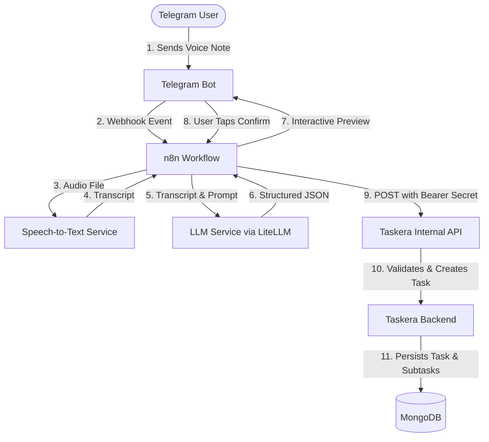
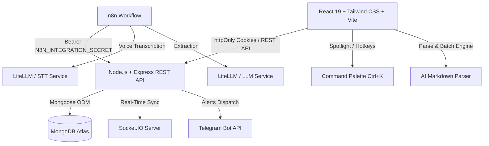

<p align="right">
  🌐 <b>Language:</b> 🇺🇸 English | <a href="./README.fa.md"><b>🇮🇷 فارسی</b></a>
</p>

# Taskera — AI-Powered Task & Workspace Management Platform

<div align="center">


[](https://react.dev)
[](https://nodejs.org)
[](https://mongodb.com)
[](https://core.telegram.org/bots/api)
[](https://tailwindcss.com)

<p align="center">
  A modern, full-stack Task & Workspace Platform featuring AI-Powered Telegram Voice-to-Task, AI Markdown Batch Sync, Real-Time Telegram Alerts, Time Tracking & Granular RBAC across Personal & Team Workspaces.
</p>

[Live Demo](https://parham-codes.github.io/Taskera) • [Author Profile](https://github.com/Parham-Codes) • [Report Issue](https://github.com/Parham-Codes/taskera/issues)

</div>

---

## 🌟 Overview

**Taskera** is an engineering-first task and workspace platform built for high-performance individual productivity and collaborative team execution. It unifies zero-friction personal task management with multi-tenant organization infrastructure, real-time Telegram integration, and seamless voice-driven AI automation.

### 🚀 Key Highlights

- **Dual-Mode Workspace Architecture:**
  - **Personal Space (Solo Mode):** Immediate, friction-free personal task management with no setup required.
  - **Organization / Team Space (Collaborative Mode):** Multi-tenant organization support with Role-Based Access Control (Owner, Manager, Member), member task assignment, and team velocity tracking.
- **🎙️ AI-Powered Telegram Voice Assistant (Voice-to-Task):**
  - **Voice-Driven Creation:** Send voice notes directly to the Telegram bot to generate tasks without opening the browser.
  - **Speech-to-Text Transcription:** Voice audio is processed through high-accuracy STT models.
  - **Intelligent Information Extraction:** Extracts title, detailed description, due dates, priority, and actionable subtasks automatically.
  - **Relative Date Recognition:** Understands natural relative deadlines (e.g., today, tomorrow, next week) and converts them to precise ISO timestamps.
  - **Human-in-the-Loop Confirmation:** Interactive Telegram preview allows the user to review, confirm, or cancel before task creation.
  - **Direct Personal Space Injection:** Upon user approval, the task and all subtasks are saved directly to the user's Personal Space matching their Telegram Chat ID.
  - **Status Feedback:** Telegram messages update dynamically to reflect processing, success, or error states.
- **⚡ Real-Time Telegram Bot Alerts:**
  - Connect your Telegram account via Chat ID or custom bot token.
  - Receive instant notifications for newly assigned tasks, status changes, and workspace events.
  - Test connectivity with 1-click test dispatches directly from the web app.
- **✨ AI Markdown Batch Import & Export:**
  - Paste structured AI-generated Markdown (or use our built-in one-click prompt) to create dozens of tasks in milliseconds.
  - Export workspace tasks into `.csv` (Excel compatible) or structured `.md` files.
- **⏱️ Integrated Time Tracker & Stopwatch:**
  - Track time spent per task with live second-by-second stopwatch sessions.
  - Detailed historical breakdown of work intervals and total elapsed time.
- **⌨️ Universal Command Palette (`Ctrl + K` / `Cmd + K`):**
  - Instant spotlight search across all tasks, workspace actions, category managers, view modes, and theme toggling.
- **💬 Task Discussion & Collaboration:**
  - Dedicated threaded discussions per task for real-time collaboration.
- **🎨 Rich Modern Aesthetic & Bilingual Support:**
  - Polished glassmorphism UI with curated color palettes, dark & light themes, micro-animations, and full RTL/LTR bilingual support (Persian with Vazirmatn & English with Plus Jakarta Sans).

---

## 🎙️ AI-Powered Telegram Voice Assistant

Taskera features an automated, voice-driven task assistant powered by an event-driven pipeline bridging Telegram, an external **n8n workflow**, **LiteLLM / STT services**, and Taskera's secure internal API.

### A. How It Works

1. The user sends a **voice note** in a private 1-on-1 chat with the Telegram Bot.
2. The **n8n workflow** receives the incoming Telegram voice message.
3. The audio file is dispatched to an STT (Speech-to-Text) service for transcription.
4. The transcribed text is sent to an LLM (Large Language Model) for semantic extraction.
5. The LLM parses task details into a structured JSON payload (title, description, due date, priority, and subtasks).
6. A rich task preview with confirmation buttons (Approve / Cancel) is sent back to the user in Telegram.
7. The user reviews the preview and taps **Confirm** (tasks are never created without explicit user confirmation).
8. Upon confirmation, n8n sends the structured data to Taskera's authenticated internal API endpoint.
9. Taskera validates the payload, verifies the user by Telegram Chat ID, and persists the task and subtasks in the user's Personal Space.
10. The original Telegram message updates dynamically to show confirmation.

### B. AI Output Structure Example

Below is the standard JSON structure produced by the AI extraction pipeline:

```json
{
  "title": "Prepare project presentation",
  "description": "Prepare the final presentation for the project.",
  "dueDate": "2026-11-12T23:59:00+03:30",
  "priority": "high",
  "subtasks": [
    {
      "title": "Review project requirements"
    },
    {
      "title": "Prepare presentation slides"
    },
    {
      "title": "Practice the presentation"
    }
  ]
}
```

- `dueDate`: ISO date-time string, or `null` if no deadline was specified in the voice message.
- `priority`: Evaluated as `low`, `medium`, or `high` based on conversational urgency.
- `subtasks`: An array of actionable subtask objects; empty array (`[]`) if no subtasks were mentioned.

### C. Prerequisites

To utilize the Voice Assistant capability, the following components are required:

- **Taskera Backend** (with `N8N_INTEGRATION_SECRET` configured)
- **Telegram Bot API** (dedicated bot token for the voice assistant)
- **n8n Workflow Automation Engine** (hosts the trigger, approval buttons, and dispatch logic)
- **LiteLLM / AI Model Provider** (STT model such as Whisper and an LLM for structured extraction)
- **Active Taskera Telegram Connection** (configured in user settings)

> [!NOTE]
> The n8n workflow and AI services operate as an external automation layer. They are not bundled as internal dependencies of Taskera's core server and must be hosted/configured independently.

### D. Enabling Voice Assistant in Taskera

1. Log into your Taskera account.
2. Open the **Telegram Settings** modal (`TelegramSettingsModal`).
3. Enter your numeric **Telegram Chat ID** (obtainable from `@userinfobot`).
4. Click **Save Settings**.
5. In the **Telegram Voice Assistant** section (`TelegramAssistantSection`), toggle the assistant switch to **Enabled**.
6. Send a voice message to your Telegram bot.

> [!IMPORTANT]
> The assistant requires a valid, saved Telegram Chat ID. The toggle cannot be enabled without a registered Chat ID.

### E. Service Architecture & Communication



Requests between n8n and Taskera are authenticated using a shared secret via `Authorization: Bearer <N8N_INTEGRATION_SECRET>`, evaluated with timing-safe comparisons to prevent token exposure or timing attacks.

---

## 🔒 Internal Telegram Assistant API

Taskera provides a dedicated, protected internal endpoint for external automation tools (such as n8n):

`POST /api/internal/telegram/assistant/tasks`

- **Route Definition:** [`server/src/routes/internalRoutes.js`](file:///server/src/routes/internalRoutes.js)
- **Authentication Middleware:** [`server/src/middlewares/n8nAuth.js`](file:///server/src/middlewares/n8nAuth.js)
- **Environment Variable:** `N8N_INTEGRATION_SECRET`
- **Header:** `Authorization: Bearer <N8N_INTEGRATION_SECRET>`

### Request Payload

```json
{
  "telegramUserId": "123456789",
  "telegramChatId": "123456789",
  "chatType": "private",
  "isBot": false,
  "task": {
    "title": "Prepare project presentation",
    "description": "Prepare the final presentation.",
    "dueDate": null,
    "priority": "medium",
    "subtasks": [
      {
        "title": "Prepare the slides"
      },
      {
        "title": "Review the content"
      }
    ]
  }
}
```

### Security & Validation Rules

- **Private Chat Enforcement:** Requests are only accepted if `chatType === 'private'`. Group or channel messages are rejected (`400 Bad Request`).
- **Bot Rejection:** Messages sent by bots (`isBot: true`) are rejected (`400 Bad Request`).
- **ID Matching:** `telegramUserId` and `telegramChatId` must match identically.
- **Account Verification:** Looks up user where `telegramSettings.chatId === telegramUserId` and `telegramSettings.assistantEnabled === true`.
- **Ambiguity Guard:** If multiple user accounts claim the same Telegram Chat ID, the request is rejected with `409 Conflict`.
- **Personal Space Target:** Tasks are persisted via `taskCrudService.createTask` with `organizationId: null`, placing them safely in the user's Personal Space.
- **Subtask Sanitization:** Subtasks are validated to ensure only non-empty, trimmed titles are stored.

---

## 🛠️ Architecture & Tech Stack



| Layer | Technologies |
|---|---|
| **Frontend** | React 19, Vite, Tailwind CSS, Lucide Icons, Vazirmatn & Plus Jakarta Sans |
| **Backend** | Node.js (ES Modules), Express, Helmet, Rate Limiter, Cookie Parser, Socket.IO |
| **Database** | MongoDB with Mongoose (Compound indexes, Lean projections) |
| **Authentication** | Secure `httpOnly` JWT sessions with silent refresh token rotation |
| **Integrations** | Telegram Bot API, n8n Workflow Automation, LiteLLM-compatible STT/LLM endpoints, AI Markdown Parser, CSV/Markdown export |

---

## 📁 Repository Structure

```
taskera/
├── client/                     # Frontend SPA (React + Vite)
│   ├── src/
│   │   ├── api/                # API Axios client & endpoint modules
│   │   ├── components/         # Reusable UI primitives, ContextMenu & CommandPalette
│   │   ├── context/            # Global contexts (Auth, Workspace, Theme, Lang, Category, Notification)
│   │   ├── features/           # Feature slices (tasks, categories, telegram)
│   │   │   ├── tasks/          # Kanban, Focused Stack, List, Calendar views & Modals
│   │   │   ├── categories/     # Category Manager & Edit modals
│   │   │   └── telegram/       # Telegram settings & Voice Assistant section
│   │   ├── layouts/            # Sidebar, TopHeader, and Footer
│   │   └── i18n/               # Comprehensive bilingual dictionary (FA / EN)
│   └── public/                 # Optimized vector brand favicon & assets
│
└── server/                     # Backend API (Node.js + Express)
    ├── src/
    │   ├── config/             # Database connection & env configs
    │   ├── controllers/        # Request handlers (tasks, auth, telegram, assistant)
    │   ├── middlewares/        # Auth verification, RBAC, n8n Bearer auth, Rate-limiters
    │   ├── models/             # Strict Mongoose Schemas (User, Task, Organization, Member, Category)
    │   ├── routes/             # Isolated modular REST routes & internal endpoints
    │   └── services/           # Task CRUD, Socket.IO, Reminders, and Telegram service
    ├── scripts/                # Utility scripts (setTelegramWebhook)
    └── tests/                  # Automated integration tests (auth, rbac, socket, assistant)
```

---

## ⚡ Quick Start

### 1. Prerequisites
- **Node.js**: v18.0.0 or higher
- **MongoDB**: Local MongoDB instance or free MongoDB Atlas URI

### 2. Clone the Repository
```bash
git clone https://github.com/Parham-Codes/taskera.git
cd taskera
```

### 3. Backend Setup
```bash
cd server
npm install
```

Create a `.env` file inside `server/`:
```env
PORT=7000
NODE_ENV=development
CLIENT_URL=http://localhost:5173
MONGO_URI=your_mongodb_connection_string

# JWT Secrets (Mandatory - server halts if not defined)
JWT_ACCESS_SECRET=your_jwt_access_secret_key_here
JWT_REFRESH_SECRET=your_jwt_refresh_secret_key_here

# Telegram Notifications Bot Token (Optional for basic alerts)
TELEGRAM_BOT_TOKEN=your_telegram_bot_token

# Required only when using the n8n Telegram Voice Assistant
N8N_INTEGRATION_SECRET=replace_with_a_long_random_secret
```

Start the backend server:
```bash
npm run dev
```

### 4. n8n Voice Assistant Setup (Optional)

If you wish to enable the AI-powered voice assistant:
1. Set `N8N_INTEGRATION_SECRET` in your backend environment (e.g., in Render or local `.env`).
2. In your n8n workflow, configure the HTTP Request node to target:
   - **Method:** `POST`
   - **URL:** `https://your-backend-domain.com/api/internal/telegram/assistant/tasks`
   - **Header:** `Authorization: Bearer <your_n8n_integration_secret>`
3. Ensure n8n passes the audio file through an STT model, formats the JSON using an LLM, and prompts the user for confirmation prior to calling this endpoint.

### 5. Frontend Setup
In a new terminal:
```bash
cd client
npm install
npm run dev
```

Open `http://localhost:5173` in your browser.

---

## 👤 Author

Developed by **Parham Taghikhani**

- **GitHub:** [@Parham-Codes](https://github.com/Parham-Codes)
- **Portfolio:** [parham-codes.github.io/portfolio](https://parham-codes.github.io/portfolio/)
- **Email:** [parhamtaghikhani.31@gmail.com](mailto:parhamtaghikhani.31@gmail.com)

---

## 📄 License

This project is licensed under the [MIT License](LICENSE).

---

<div align="center">

### ⭐ If you found this project helpful, consider giving it a Star!

</div>
